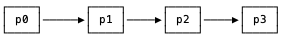
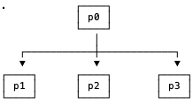
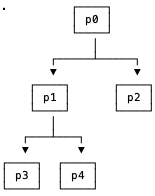

# Administración de Procesos en Unix

> **Nota para Windows:** los ejemplos de este tutorial usan llamadas Unix (`fork`, `wait`, `waitpid`, `getppid`). Puede ejecutarlos en Windows con TDM-GCC/MinGW-w64 usando la biblioteca **unixlib**: <https://github.com/arce/unixlib>. Basta compilar con `gcc -I<ruta>/include -I<ruta>/compat programa.c -o programa.exe`, sin modificar el código.

## Introducción a la Gestión de Procesos

La administración de procesos es uno de los pilares fundamentales de los sistemas operativos Unix y Linux. Un proceso es esencialmente un programa en ejecución que incluye el código del programa, los datos asociados, el contador de programa (PC), los registros del procesador, y la información de la pila. Cada proceso en el sistema tiene un identificador único llamado PID (Process IDentifier), que es asignado por el núcleo del sistema operativo en el momento de su creación.

En Unix, la función *getid()* retorna el *PID* de cada proceso. El *PID* es un identificador único para cada proceso en el sistema. También es posible recuperar el *PID* del padre del proceso mediante la función *getppid()*. Cada proceso está asociado a un usuario cuyo identificador se puede recuperar mediante la función *getuid()*.

```c
#include <stdio.h>
#include <unistd.h>
int main () {
  printf ("The process ID is %d\n", (int) getpid ());
  printf ("The parent process ID is %d\n",
          (int) getppid ());
  printf ("The user ID is %d\n",
          (int) getuid ());
  return 0;
}
```

### El Espacio de Direcciones de un Proceso

Cuando un proceso se ejecuta, el sistema operativo le asigna un espacio de direcciones virtual que contiene:

- **Segmento de texto**: Contiene el código ejecutable del programa
- **Segmento de datos**: Almacena variables globales y estáticas inicializadas
- **Segmento BSS**: Almacena variables globales y estáticas no inicializadas
- **Heap**: Memoria dinámica asignada durante la ejecución
- **Stack**: Almacena variables locales y información de llamadas a funciones

Cuando se realiza un *fork()*, el sistema operativo crea una copia exacta de todo este espacio de direcciones para el nuevo proceso hijo. Sin embargo, gracias al mecanismo de copia en escritura (copy-on-write), las páginas de memoria se comparten inicialmente y solo se copian cuando alguno de los procesos intenta modificarlas, optimizando así el uso de memoria.

### Estados de un Proceso

Un proceso en Unix puede encontrarse en diferentes estados durante su ciclo de vida:

- **Ejecución**: El proceso está utilizando la CPU
- **Listo**: El proceso está listo para ejecutarse pero espera su turno
- **Bloqueado**: El proceso está esperando por algún evento (I/O, señal, etc.)
- **Zombie**: El proceso ha terminado pero su entrada en la tabla de procesos aún existe
- **Huérfano**: Proceso cuyo padre ha terminado antes que él

La comprensión de estos estados es fundamental para entender el comportamiento de los procesos creados mediante *fork()*.

```c
#include <stdio.h>
#include <unistd.h>
#include <sys/types.h>
#include <sys/wait.h>
#include <stdlib.h>

int main() {
    pid_t pid;
    int status;
    
    printf("Proceso padre: PID=%d\n", getpid());
    
    pid = fork();
    
    if (pid == 0) {
        // Proceso hijo
        printf("Hijo: PID=%d, PPID=%d\n", getpid(), getppid());
        printf("Hijo: Durmiendo 3 segundos...\n");
        sleep(3);
        printf("Hijo: Terminando\n");
        exit(42);
    } else if (pid > 0) {
        // Proceso padre
        printf("Padre: Hijo creado con PID=%d\n", pid);
        printf("Padre: Esperando al hijo...\n");
        wait(&status);
        if (WIFEXITED(status)) {
            printf("Padre: Hijo terminó con estado %d\n", WEXITSTATUS(status));
        }
        printf("Padre: Terminando\n");
    } else {
        perror("Error en fork");
        exit(1);
    }
    
    return 0;
}
```

## Cadena de procesos

La instrucción *fork()* permite clonar el proceso actual. Esta instrucción retorna el número de *PID* del nuevo proceso creado al "padre", y 0 al proceso "hijo". Luego de la ejecución del *fork* existirán dos procesos con exactamente el mismo código, variables, etc. Si el proceso padre desea esperar a que su proceso hijo termine puede utilizar la función *wait(&status)*. Esta función retornará en *PID* del proceso hijo recién terminado y en *&status* el estado de terminación del mismo. El proceso hijo retorna su estado de terminación mediante la función *exit(status)*. Generalmente un valor de -1 en *status* representa un código de terminación con error.



El siguiente código muestra la estrategia para crear una cadena de procesos, es decir, un conjunto de procesos en donde cada uno crea únicamente un proceso hijo. En este caso el proceso padre ejecuta una única llamada a la función *fork()* y el proceso hijo una vez creado realiza también una única llamada a dicha función.

En una cadena de procesos, cada proceso solo crea un hijo y luego espera a que este termine antes de finalizar. Esto crea una estructura lineal de procesos donde cada uno depende del siguiente. Esta estructura es útil cuando se necesita un procesamiento secuencial donde cada etapa depende de la anterior.

```c
#include <sys/types.h>
#include <sys/wait.h>
#include <unistd.h>
#include <stdlib.h>
int main () {
  int status,i,n=3;
  for (i=0; i<n; i++) {
    if (fork()!=0) break;
  }
  printf ("Process ID: %ld, Parent ID: %ld\n",
          (long)getpid(), (long)getppid());
  wait(&status);
  exit(0); 
}
```

### Detalles Importantes en la Cadena de Procesos

En el código anterior, el bucle `for` itera `n` veces. En cada iteración, el proceso actual (que puede ser el original o un hijo) ejecuta `fork()`. Si el resultado es diferente de 0 (es decir, estamos en el proceso padre), se ejecuta `break`, saliendo del bucle. Esto significa que el padre solo crea un hijo y luego termina. El hijo, al recibir 0, continúa en la siguiente iteración del bucle, creando su propio hijo. De esta forma se forma una cadena de `n+1` procesos (el proceso original más `n` hijos).

```c
#include <sys/types.h>
#include <sys/wait.h>
#include <unistd.h>
#include <stdlib.h>
#include <stdio.h>

int main() {
    int status, i, n = 5;
    pid_t pid;
    
    printf("Iniciando cadena de procesos - PID inicial: %d\n", getpid());
    
    for (i = 0; i < n; i++) {
        pid = fork();
        if (pid != 0) {
            // Este es el padre
            printf("Proceso %d: He creado al hijo %d\n", getpid(), pid);
            wait(&status);
            printf("Proceso %d: Mi hijo ha terminado\n", getpid());
            break;
        }
        // El hijo continúa en el bucle
        printf("Proceso %d: Soy hijo de %d, continuando la cadena\n", 
               getpid(), getppid());
    }
    
    if (pid == 0) {
        // Último proceso de la cadena
        printf("Proceso %d: Soy el último de la cadena, terminando\n", getpid());
        wait(&status);
    }
    
    exit(0);
}
```

## Abanico de procesos

Otra estrategia, que es necesaria en ciertas situaciones, es que un único proceso cree varios hijos que son ejecutados en forma concurrente. De esta forma dicho proceso debe continuar ejecutando la función *fork()* tantas veces como se requiera pero el hijo una vez creado no debe ejecutar un nuevo *fork()*.



El siguiente ejemplo muestra esta estrategia de creación de procesos hijos.

En un abanico de procesos, un único proceso padre crea múltiples procesos hijos que se ejecutan concurrentemente. Cada hijo realiza su tarea de forma independiente y el padre puede esperar a que todos terminen o continuar con otras tareas. Esta estructura es ideal para paralelizar tareas independientes.

```c
#include <sys/types.h>
#include <sys/wait.h>
#include <unistd.h>
#include <stdlib.h>
int main () {
  int status,i,n=3;
  for (i=0; i<n; i++) {
    if (fork() == 0) break;
  }
  printf ("Process ID: %ld, Parent ID: %ld\n",
            (long)getpid (), (long)getppid());
  wait(&status);
  exit(0); 
}
```

### Características del Abanico de Procesos

En el código anterior, el bucle `for` itera `n` veces. En cada iteración, el proceso actual (que inicialmente es el padre) ejecuta `fork()`. Si el resultado es 0 (estamos en el hijo), se ejecuta `break`, saliendo del bucle. Esto significa que cada hijo solo realiza su tarea y no crea más procesos. El padre, al recibir el PID del hijo (diferente de 0), continúa en la siguiente iteración creando otro hijo. De esta forma, el padre crea `n` hijos que se ejecutan concurrentemente.

```c
#include <sys/types.h>
#include <sys/wait.h>
#include <unistd.h>
#include <stdlib.h>
#include <stdio.h>

int main() {
    int status, i, n = 5;
    pid_t pid;
    pid_t hijos[5];
    
    printf("Padre: PID=%d, creando %d hijos\n", getpid(), n);
    
    for (i = 0; i < n; i++) {
        pid = fork();
        if (pid == 0) {
            // Proceso hijo
            printf("Hijo %d: PID=%d, PPID=%d\n", i+1, getpid(), getppid());
            sleep(i + 1); // Cada hijo duerme diferente tiempo
            printf("Hijo %d: Terminando\n", i+1);
            exit(i + 1);
        } else {
            // Proceso padre
            hijos[i] = pid;
            printf("Padre: Hijo %d creado con PID=%d\n", i+1, pid);
        }
    }
    
    // El padre espera a todos los hijos
    printf("Padre: Esperando a todos los hijos\n");
    for (i = 0; i < n; i++) {
        pid = wait(&status);
        if (WIFEXITED(status)) {
            printf("Padre: Hijo %d terminó con estado %d\n", 
                   pid, WEXITSTATUS(status));
        }
    }
    
    printf("Padre: Todos los hijos han terminado\n");
    exit(0);
}
```

## Arbol de procesos

Existe también la situación más general en donde tanto padre como hijos requieren crear un conjunto determinado de sub procesos. Bajo esta situación tanto el padre como los procesos hijos ejecutarán nuevas llamadas a la función *fork()* luego de ser creados.



Note que si no se espera a que terminen los hijos, ellos pueden quedar huérfanos y el *PID* del padre que se obtengan sea 1. También note que, en este ejemplo, no todos los hijos van a crear tres hijos pues el contador *i* va avanzando conforme se clonan los procesos.

En un árbol de procesos, cada proceso puede crear múltiples hijos, y estos a su vez pueden crear sus propios hijos, formando una estructura jerárquica. Esta es la estructura más general y permite implementar sistemas complejos de procesamiento distribuido.

```c
#include <sys/types.h>
#include <sys/wait.h>
#include <unistd.h>
#include <stdlib.h>
int main () {
  int i,status,n=3;
  for (i=0; i<n; i++) fork();
  printf ("Process ID: %ld, Parent ID: %ld\n",
           (long)getpid (), (long)getppid());
  for (i=0; i<n; i++) wait(&status);
  exit(0);
}
```

### Análisis del Árbol de Procesos

En el código anterior, el bucle `for` itera `n` veces y en cada iteración se ejecuta `fork()`. Esto significa que cada proceso existente en ese momento crea un nuevo hijo. La cantidad total de procesos creados será de 2^n (incluyendo el proceso original). Por ejemplo, con n=3, se crearán 8 procesos en total.

Es importante notar que los procesos hijos también ejecutan el bucle desde el punto donde fueron creados, por lo que algunos hijos crearán más procesos que otros dependiendo de en qué iteración fueron creados.

```c
#include <sys/types.h>
#include <sys/wait.h>
#include <unistd.h>
#include <stdlib.h>
#include <stdio.h>

int main() {
    int i, j, status, n = 2;
    pid_t pid;
    
    printf("Proceso raíz: PID=%d, nivel=0\n", getpid());
    
    for (i = 0; i < n; i++) {
        pid = fork();
        if (pid == 0) {
            // Proceso hijo
            printf("Proceso: PID=%d, PPID=%d, nivel=1\n", getpid(), getppid());
            
            // Los hijos también crean sus propios hijos
            for (j = 0; j < n; j++) {
                fork();
            }
            
            // Esperar a los hijos de este proceso
            for (j = 0; j < n; j++) {
                wait(&status);
            }
            
            printf("Proceso %d: terminando\n", getpid());
            exit(0);
        }
    }
    
    // El proceso raíz espera a sus hijos
    for (i = 0; i < n; i++) {
        wait(&status);
    }
    
    printf("Proceso raíz: todos terminaron\n");
    exit(0);
}
```

## Espera no bloqueante

Como se indicó anteriormente al llamar a la función *wait(&status)* el proceso padre se queda "bloqueado" esperando que un hijo termine. Debido a esto el proceso padre no puede ejecutar ninguna instrucción hasta ser "despertado". En ocasiones se requiere que el proceso pueda ejecutar alguna otra tarea y no que se quede "dormido" sin hacer nada. Para hacer esto se debe invocar a la función *wait* con un par de parámetros adicionales que indiquen el no bloqueo, de esta forma la función tendría la forma: *wait(-1,&status,WNOHANG)*.

La espera no bloqueante es especialmente útil cuando el proceso padre necesita realizar otras tareas mientras sus hijos están ejecutándose. En lugar de bloquearse esperando, el padre puede verificar periódicamente el estado de sus hijos y continuar con su trabajo.

```c
#include <sys/types.h>
#include <sys/wait.h>
#include <unistd.h>
#include <stdlib.h>
int main () {
  int child, status;
  pid_t pid = fork();
  while ((pid != 0) && 
	       ((child = waitpid(-1,&status,WNOHANG))==0)) { 
    printf ("Esperando ..\n");
  }
  if (pid!=0) { // el padre
    printf("Final de hijo: %ld\n",child);
  } else { // el hijo
    sleep(1);
    printf("Child ID: %ld\n", (long)getpid());
  }
  exit(0);
}
```

### Ventajas de la Espera No Bloqueante

La espera no bloqueante permite al proceso padre:

- Realizar otras tareas mientras espera a sus hijos
- Verificar periódicamente el estado de los hijos
- Manejar múltiples hijos de manera más eficiente
- Implementar timeouts y mecanismos de control más sofisticados

```c
#include <sys/types.h>
#include <sys/wait.h>
#include <unistd.h>
#include <stdlib.h>
#include <stdio.h>
#include <time.h>

int main() {
    int status, i, n = 3;
    pid_t pid;
    pid_t hijos[3];
    int terminados = 0;
    
    printf("Padre: PID=%d, creando %d hijos\n", getpid(), n);
    
    // Crear hijos
    for (i = 0; i < n; i++) {
        pid = fork();
        if (pid == 0) {
            // Hijo
            srand(time(NULL) ^ getpid());
            int tiempo = rand() % 5 + 2; // 2-6 segundos
            printf("Hijo %d: PID=%d, trabajando %d segundos\n", 
                   i+1, getpid(), tiempo);
            sleep(tiempo);
            printf("Hijo %d: Terminado\n", i+1);
            exit(i+1);
        } else {
            hijos[i] = pid;
        }
    }
    
    // Espera no bloqueante
    printf("Padre: Realizando espera no bloqueante\n");
    while (terminados < n) {
        pid = waitpid(-1, &status, WNOHANG);
        if (pid > 0) {
            // Un hijo terminó
            if (WIFEXITED(status)) {
                printf("Padre: Hijo %d terminó con estado %d\n", 
                       pid, WEXITSTATUS(status));
                terminados++;
            }
        } else if (pid == 0) {
            // Ningún hijo terminó, hacer otra cosa
            printf("Padre: Realizando otra tarea...\n");
            sleep(1);
        } else {
            perror("Error en waitpid");
            break;
        }
    }
    
    printf("Padre: Todos los hijos terminaron\n");
    exit(0);
}
```

## Cancelación de procesos

La instrucción *kill(-pid,SIGKILL)* permite cancelar un proceso hijo que se encuentre en ejecución. Cancelar un proceso de esta forma no siempre es conveniente pues el proceso puede estar realizando alguna operación que deje recursos en algún estado inconsistente (por ejemplo archivos).

La cancelación de procesos debe realizarse con cuidado. Es preferible usar señales como SIGTERM que permiten al proceso realizar una limpieza antes de terminar, en lugar de SIGKILL que termina el proceso de forma inmediata.

```c
#include <sys/types.h>
#include <sys/wait.h>
#include <unistd.h>
#include <stdlib.h>
#include <signal.h>
int main () {
	pid_t pid = fork();
  if (pid == 0) { // el hijo
    while (1)
      printf ("Hijo corriendo ...\n");
  } else {  // el padre
    sleep(1);
    kill(pid, SIGKILL);
  }
  exit(0);
}
```

### Mecanismos de Cancelación Controlada

Para una cancelación más controlada, se pueden implementar manejadores de señales que permitan al proceso realizar una limpieza antes de terminar.

```c
#include <sys/types.h>
#include <sys/wait.h>
#include <unistd.h>
#include <stdlib.h>
#include <signal.h>
#include <stdio.h>

int ejecutando = 1;

void manejador_terminacion(int sig) {
    printf("Proceso %d: Recibida señal de terminación, realizando limpieza...\n", 
           getpid());
    ejecutando = 0;
}

int main() {
    pid_t pid = fork();
    
    if (pid == 0) {
        // Proceso hijo
        signal(SIGTERM, manejador_terminacion);
        signal(SIGINT, manejador_terminacion);
        
        printf("Hijo: PID=%d, trabajando...\n", getpid());
        while (ejecutando) {
            printf("Hijo: Realizando trabajo...\n");
            sleep(1);
        }
        printf("Hijo: Terminando de forma ordenada\n");
        exit(0);
    } else {
        // Proceso padre
        printf("Padre: PID=%d, hijo creado con PID=%d\n", getpid(), pid);
        sleep(3);
        printf("Padre: Enviando señal de terminación al hijo\n");
        kill(pid, SIGTERM);
        wait(NULL);
        printf("Padre: Hijo terminado\n");
    }
    
    exit(0);
}
```

## Gestión de Procesos Huérfanos y Zombies

### Procesos Zombies

Un proceso zombie es aquel que ha terminado su ejecución pero aún mantiene una entrada en la tabla de procesos porque su padre no ha llamado a `wait()` para recolectar su estado de terminación. Los zombies consumen recursos del sistema (aunque mínimos) y pueden acumularse si el padre no los recolecta adecuadamente.

```c
#include <sys/types.h>
#include <sys/wait.h>
#include <unistd.h>
#include <stdlib.h>
#include <stdio.h>

int main() {
    pid_t pid;
    int i;
    
    printf("Creando procesos zombie...\n");
    
    for (i = 0; i < 5; i++) {
        pid = fork();
        if (pid == 0) {
            // Proceso hijo: termina inmediatamente
            printf("Hijo %d: PID=%d, terminando\n", i+1, getpid());
            exit(0);
        } else {
            // Padre no espera a los hijos, creando zombies
            printf("Padre: Creó hijo %d con PID=%d (no esperará)\n", 
                   i+1, pid);
        }
    }
    
    // El padre duerme para que los hijos se conviertan en zombies
    printf("Padre: Durmiendo 10 segundos mientras los hijos son zombies...\n");
    sleep(10);
    
    // Ahora el padre recolecta a todos los hijos
    printf("Padre: Recolectando hijos zombies...\n");
    for (i = 0; i < 5; i++) {
        pid = wait(NULL);
        if (pid > 0) {
            printf("Padre: Recolectado hijo %d\n", pid);
        }
    }
    
    printf("Padre: Terminando\n");
    exit(0);
}
```

### Procesos Huérfanos

Un proceso huérfano es aquel cuyo padre ha terminado antes que él. En Unix, los procesos huérfanos son adoptados por el proceso init (PID 1), que se encarga de recolectarlos cuando terminan.

```c
#include <sys/types.h>
#include <sys/wait.h>
#include <unistd.h>
#include <stdlib.h>
#include <stdio.h>

int main() {
    pid_t pid;
    
    pid = fork();
    
    if (pid == 0) {
        // Proceso hijo
        printf("Hijo: PID=%d, PPID=%d\n", getpid(), getppid());
        printf("Hijo: Durmiendo 5 segundos...\n");
        sleep(5);
        printf("Hijo: Ahora mi PPID es %d (debería ser 1 si mi padre terminó)\n", 
               getppid());
        printf("Hijo: Terminando\n");
        exit(0);
    } else {
        // Proceso padre
        printf("Padre: PID=%d, creé al hijo %d\n", getpid(), pid);
        printf("Padre: Terminando antes que mi hijo\n");
        exit(0);
    }
    
    return 0;
}
```

## Ejercicios


1. Cree una cadena de 5 procesos: cada proceso crea un único hijo y espera a que termine antes de finalizar. Cada proceso debe imprimir su nivel (0 para el primero), su *PID* y el *PID* de su padre; los padres también imprimen el *PID* de su hijo.

2. Cree un padre que genere un abanico de 7 hijos. El hijo *i* imprime su número de orden y duerme *i* segundos. El padre espera a todos los hijos e imprime, en el orden en que terminan, el *PID* de cada uno, y un mensaje final.

3. Cree un padre con un abanico de 8 hijos. El hijo *i* calcula la suma de 1 hasta *i* y la retorna como estado de terminación (`exit`). El padre recupera el estado de cada hijo con `wait` y `WEXITSTATUS`, e imprime las sumas.

4. Cree un padre con 5 hijos. Cada hijo genera un número aleatorio pequeño (entre 1 y 100), lo imprime y lo retorna como estado de terminación. El padre debe imprimir cuál fue el mayor número recibido y el *PID* del hijo que lo produjo.

5. Cree un proceso principal con 3 hijos, y cada hijo con 2 nietos. Cada proceso imprime su nivel (0, 1 o 2), su *PID* y el *PID* de su padre, y espera a todos sus descendientes directos antes de terminar.

6. Escriba un programa recursivo que cree un árbol binario de procesos de profundidad 3 (cada proceso crea dos hijos hasta llegar al nivel 3). Cada proceso imprime su nivel y su *PID*, y espera a sus hijos. El proceso raíz imprime el tiempo total de ejecución.

7. Cree tres procesos A, B y C de forma que A duerma 2 segundos y luego espere a que termine B, que dormirá 4 segundos y luego esperará a que termine C, que dormirá 6 segundos. Cada proceso imprime un mensaje cuando termina de dormir y otro cuando termina la espera.

8. Cree un padre con 5 hijos que entran en un ciclo infinito esperando ser cancelados. Apenas termine de crearlos, el padre envía una señal `SIGTERM` a cada hijo con `kill`. Cada hijo debe imprimir su *PID* al ser cancelado (use un manejador de señal) y el padre debe esperar a que todos terminen.

9. Cree un padre con 6 hijos. Los hijos con número de orden par terminan normalmente con `exit(orden)`; los de orden impar se terminan a sí mismos con una señal (por ejemplo `kill(getpid(), SIGTERM)`). El padre usa `WIFEXITED`, `WEXITSTATUS`, `WIFSIGNALED` y `WTERMSIG` para imprimir cómo terminó cada hijo.

10. Cree un padre con 3 hijos que duermen 2, 4 y 6 segundos. El padre no debe bloquearse: cada segundo imprime "esperando..." y revisa con `waitpid(-1, &estado, WNOHANG)` si algún hijo terminó. El programa finaliza cuando los 3 han terminado.

11. Cree un hijo que imprima su *PID* y el de su padre, duerma 3 segundos y vuelva a imprimir el *PID* de su padre. El padre termina inmediatamente después de crear al hijo. Explique por qué el valor impreso por el hijo cambia.

12. Escriba un programa que reciba por línea de comandos un número *N* (valide que esté entre 1 y 20) y cree un abanico de *N* hijos. Cada hijo imprime su número de orden y su *PID*. El padre espera a todos los hijos e imprime el tiempo total transcurrido (use `time` o `gettimeofday`).
